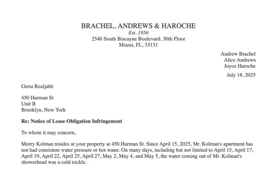
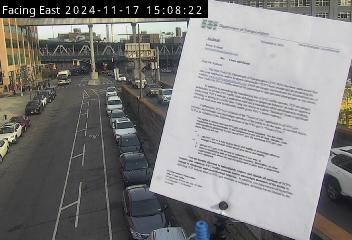
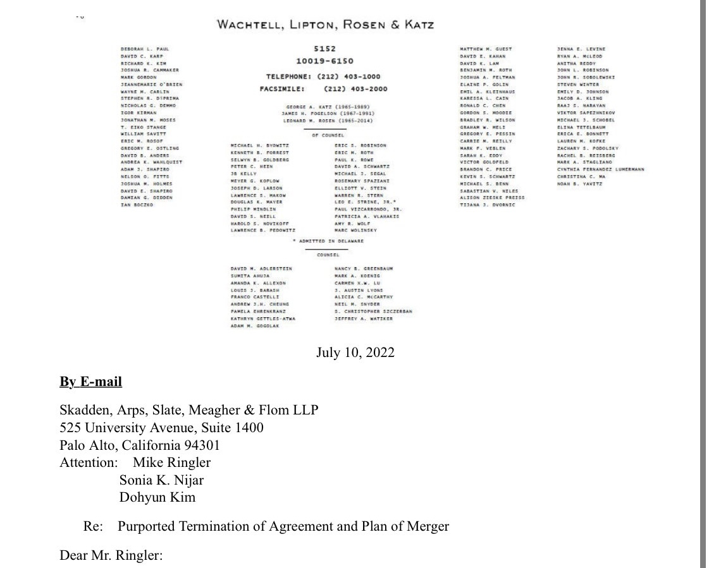
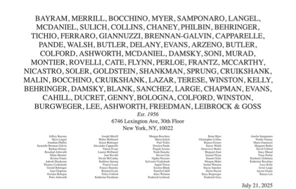

Sometimes, you don’t need a lawyer, you just need to look like you have one. 

   

 

That’s the idea behind [Heavyweight](https://heavyweight.cc/), a project that democratizes the aesthetics of (in lieu of access to) legal representation. Heavyweight is a free, online, and open-source tool that lets you give any complaint you have extremely law-firm-looking formatting and letterhead. Importantly, it does so without ever using any language that would actually claim that the letter was written by a lawyer.

Let’s back up for a second. Last month, I had the incredible honor of participating in [Rhizome](https://rhizome.org/)’s 7x7. Rhizome, for folks who don’t know, is an NYC-based organization dedicated to making, celebrating, and preserving web art. And 7x7 is their yearly event where they invite technologists to collaborate with artists to make something new. This year, instead of pairing artists with technologists, they decided, inspired by art collective provocateurs MSCHF, to pair artists with lawyers.[^1]

The artist I got paired with was the incredible [Morry Kolman](https://wttdotm.com/). If you’ve heard about Morry’s work, it’s probably because of the reporting on how his “traffic cam selfie” project got a cease and desist from the New York Department of Transportation and his incredible response.[^2]

   

 

In addition to this stunt, he also told me that he sent a proper letter back to the DoT as well, and - in order to make it look like he had more legal power on his side than just a few calls with friends that were lawyers - made his own letterhead to make it seem more legit. I’d done something similar earlier this year, with my firm putting out an  “[official statement on the Trump administration’s attack on the rule of law](https://bsky.app/profile/kendraserra.bsky.social/post/3ll2kg3szws2b)” under our letterhead as well. Taking those together, we knew that we had keyed into something interesting, a decidedly visual and subjective aspect of an otherwise pretty language-driven and objectivity-seeking profession. We became determined to make our contribution to the 7x7 canon based around the most thrilling thing that comes to mind when you think of the law: document formatting.

<iframe title="7x7 2025: Morry Kolman x Kendra Albert" width="560" height="315" src="https://video.rhizome.org/videos/embed/60a86a19-f358-4353-8223-f0223189da62" frameborder="0" allowfullscreen="" sandbox="allow-same-origin allow-scripts allow-popups"></iframe>

 

Lawyers like to think that we’re all about the facts and legal reasoning, but there’s a reason courtroom dramas feature the dramatic closing argument. It’s why lawyers swap stories about rushing to court, closing a big deal last minute, or some other “big moment.” Lawyers are not just not above spectacle, but on some level, it’s what we’re selling.

Having a lawyer show up, or send a letter, instantly changes the power dynamic in a situation. As Morry put it, it’s why getting a cease and desist letter (which is just a letter, it’s not a legal document) causes a moment of “pants shitting.” The contents of the letter, for most people, is beside the point.[^3] What’s scary is the sense of being targeted by someone who has the power to make your life miserable. That’s part of why lawyer behavior is ethically regulated, including, actually, who is allowed to be on a law firm’s letterhead.[^4]

But it’s not just about creating emotion in an opponent— lawyers sell spectacle to their clients. Law is a credence good, which means that it is often quite difficult to tell whether someone is a good lawyer, especially if one isn’t an attorney. People look to external cues to evaluate whether to take someone seriously—from billing rate, email provider, or even the fanciness of an organization’s office.[^5] This often corresponds to looking for qualities that individuals associate with big and fancy law firms, as that’s what a law firm is “supposed” to feel like, and it results in some hilarious aesthetic choices. Take a look at this letterhead from Wachtell (a very fancy law firm) from 2022! 

   

 

*It’s SO UGLY. But it screams law firm.*

Heavyweight plays on this phenomenon by making lots of aesthetic choices that law firms make, while not actually using any words that formally indicate “lawyer” (LLP, Esq, etc.). As Morry likes to say, Heavyweight bestows the representation (appearance) of representation (counsel) by avoiding any representation (statement of fact) of legitimacy. Basically, you can have the power dynamic change just based on the aesthetic elements alone, at least if the person who receives the letter isn’t really looking too closely. (Heavyweight letterhead doesn’t have phone numbers or email addresses, which is probably a pretty good indicator that something is amiss in 2025.) 

   

 

*Is that really so different than Wachtell?*

People keep asking me “do you actually want people to use it?” To be honest, I’m not sure.

I worry about people using it because I’m not sure it will work. I don’t actually think the letterhead will pass an inspection from anyone who is really paying attention, which is part of what makes it an ethical project, but also less useful for faking a lawyer.

If it does work, I don’t know how to feel. The more successful the letter is at fooling people (and we do have reports of it doing so), the more likely it is that someone might face adverse consequences for pretending that they are legally represented. When I was doing the initial legal research for this project, I could find almost no examples of legal action against non-lawyers for unauthorized practice of law for pretending to be represented by an attorney.

But ultimately, I know that sometimes, having a lawyer-shaped entity show up is all it takes to get assholes to back down or go away.  I’m not heartbroken at the idea that someone who doesn’t have the resources to get an attorney might be able to tap into the power of the law via aesthetics. After all, I can’t represent [everyone who gets a silly letter](https://www.techdirt.com/2025/07/09/litigious-company-demands-removal-of-a-tweet-linking-to-an-article-about-how-litigious-they-are/). 

<!-- Footnotes themselves at the bottom. -->
## Notes

[^1]:
     Reader, when I got the email inviting me to participate, I made possibly the most undignified noise of excitement you can imagine. I’m a big fan of MSCHF’s antics, in particular their [SCOTUS brief that had appropriation art coloring pages for each of the Supreme Court justices and their clerks](https://www.supremecourt.gov/DocketPDF/22/22-148/256068/20230302160705017_FINAL%20MSCHF%20SUPREME%20COURT%20AMICUS%20BRIEF%20w%20APPENDIX.pdf).

[^2]:
     The traffic cam selfie thing is why I thought we might get along, but to be honest, these days, my favorite work of Morry’s is his [First Light](https://firstlightstars.com/) project, where you can be the first person to see a star.

[^3]:
     To quote Annelise Riles' [work on documents](https://scholarship.law.cornell.edu/cgi/viewcontent.cgi?article=1784&context=facpub), “As we will see, the document's principal aesthetic device involves an alternation between concreteness (the document as object) and abstraction (the document as pattern).” 

[^4]:
     See [this opinion](https://www.nycla.org/resource/ethics-opinion/ethics-opinion-612-1973-letterhead-listing-associates/) from the New York County Lawyers Association, specifying thatt letterhead must differentiate between partners and associates.

[^5]:
     When Andy Sellars and I were thinking about how to present our law firm, I looked at a lot of law firm websites, and quickly discovered that there were a lot of solo or small firms that seemed to be presenting themselves as much bigger. (We ended up going the opposite direction.)
