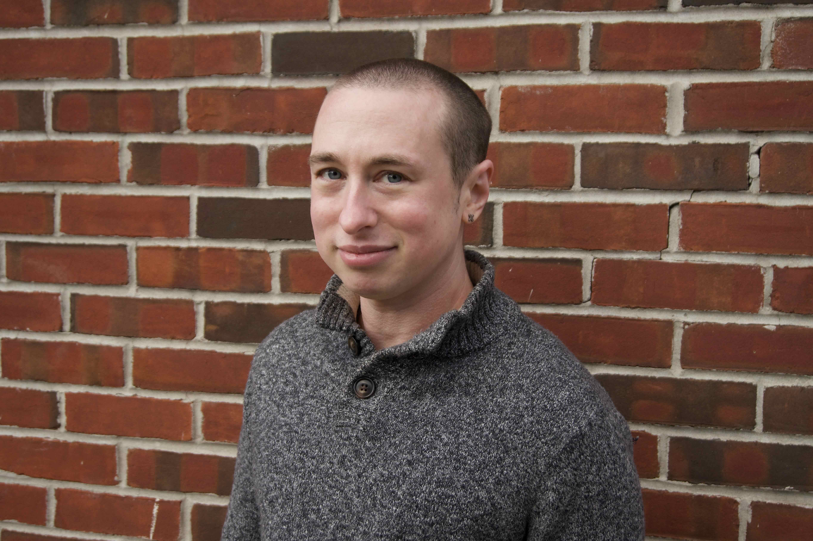

---
# Feel free to add content and custom Front Matter to this file.
# To modify the layout, see https://jekyllrb.com/docs/themes/#overriding-theme-defaults

layout: home
---

<html>
    
  
        

            <h2>Kendra Albert</h2>
                Technology Lawyer  
                 
                <!--Lecturer 
                Studies of Women, Gender and Sexuality, Harvard University -->
        

        

            
        

    

</html>

Hey there! I’m Kendra, a lawyer and a recovering academic. :) 

I run a small public interest technology and media law firm called [Albert Sellars LLP](https://www.albertsellars.law/). Prior to opening up the law firm, I worked at the Cyberlaw Clinic at Harvard Law School, where I practiced (and taught students how to practice) technology law. 

My academic identification is as an "undisciplined" scholar of computing, gender, and society. Generally, my scholarship and other public work focus on questions of digital technology and power, especially in relationship to gender and sexuality. Some representative examples:

*   My legal scholarship focuses on FOSTA/SESTA, a 2018 law that changed how liability worked for online platforms around sex trafficking and prostitution. The best place to start with that work is my essay [*Five Reflections from Five Years of FOSTA/SESTA*](../uploads/Five_Reflections_on_FOSTA.pdf), which summarizes what working with sex workers in the aftermath of FOSTA has taught me.
*   With Maggie Delano, I've written about how non-binary people are excluded from "smart scales" and what this means about the use of sex/gender in research more generally in [*This Whole Thing Smacks of Gender*](https://dl.acm.org/doi/10.1145/3442188.3445898) and [*Sex Trouble*](https://www.cell.com/patterns/fulltext/S2666-3899(22)00131-3).
*   With Ram Shankar Siva Kumar and others, I've written and spoken about how to apply law to adversarial attacks on machine learning systems. Our Blackhat talk ["Ignore Your Generative AI Safety Instructions. Violate the CFAA?"](https://www.youtube.com/watch?v=cu-3Ul3VA48) does a great job of illustrating that work.

In the past, I held an appointment as a lecturer on Studies of Women, Gender, and Sexuality at Harvard University, where I taught classes on gender and technology and transgender rights and the law. In 2019, I founded the [Initiative for a Representative First Amendment (IfRFA)](https://www.ifrfa.org/), which provided funding and support for law students from backgrounds traditionally underrepresented in First Amendment law. Until summer 2024, I served as IfRFA's director, working alongside the incredible Jasjot Kaur.

When I'm not working, I try to make the world suck less. I consult on issues related to harassment, and I reinvest money from that work into community mutual aid. Other than that, I spend my free time reading, playing video games, and cooking.

I post regularly on Bluesky](https://bsky.app/profile/kendraserra.bsky.social) and on Mastodon at <a rel="me" href="https://dair-community.social/@kendraserra">@Kendraserra@dair-community.social</a>. I occasionally blog about things I've been thinking about. Reach me by email at kendra dot serra at gmail dot com. My pronouns are [they/them/theirs](Gender). For more info on my background and accomplishments, feel free to peruse my [CV](/uploads/Kendra_CV.pdf).

Photo by Kirby Conrod.